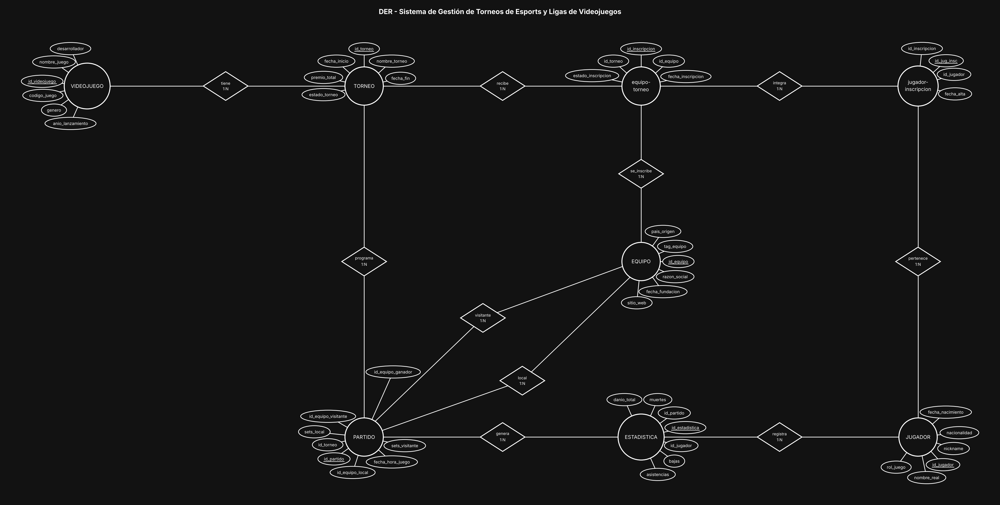

# BaseDeDatos-U2-Ej15-TorneosEsports

Base de Datos - Unidad 2 - Ejercicio 15

## Consigna

Modelar la gestión de una organización de esports: videojuegos oficiales, torneos y ligas, equipos con sus planteles de jugadores, inscripción de equipos a torneos, partidos entre dos equipos y estadísticas individuales por partido.

## Lógica

**VIDEOJUEGO 1:N TORNEO.** Cada torneo pertenece a un único videojuego y un juego tiene muchos torneos. El juego es entidad y no un texto dentro del torneo porque se repite en todos los torneos de ese título y porque tiene datos propios (género, desarrollador).

**Equipo ↔ Torneo: N:M con `equipo-torneo`.** Un equipo se anota en varios torneos y un torneo tiene varios equipos. La intermedia guarda `fecha_inscripcion` y `estado_inscripcion` (inscripto, clasificado, eliminado, descalificado), que son datos de la participación y no del equipo.

**El plantel cuelga de la inscripción, no del equipo.** Acá está el detalle fino del enunciado: dice que un jugador pertenece a un único equipo **en un torneo dado**. Eso significa que la pertenencia no es una propiedad permanente del jugador, sino de su participación en un torneo concreto: los pases entre equipos entre torneo y torneo son normales en esports. Por eso JUGADOR se relaciona N:M con `equipo-torneo` a través de `jugador-inscripcion`. La regla de "un solo equipo por torneo" se garantiza con un UNIQUE sobre (`id_jugador`, `id_torneo`), no por la estructura. La alternativa simple —EQUIPO 1:N JUGADOR— sería más chica pero borraría el historial: al pasar el jugador a otro equipo se perderían sus estadísticas atribuidas al anterior.

**PARTIDO como entidad asociativa con dos roles.** EQUIPO participa dos veces en PARTIDO, con los roles `local` y `visitante`, cada uno con su FK (`id_equipo_local`, `id_equipo_visitante`). Es el mismo mecanismo de roles que en una autorrelación. El partido también cuelga del torneo (`programa`), porque el enfrentamiento existe dentro del contexto de una competencia. El equipo ganador se registra como `id_equipo_ganador`: es una FK derivable del resultado, así que va con una restricción que la obligue a coincidir con el local o el visitante del mismo partido (y queda en NULL mientras no se juegue o si hay empate, según el formato).

**ESTADISTICA: N:M entre JUGADOR y PARTIDO.** Las bajas, muertes, asistencias y daño no son del jugador (varían partido a partido) ni del partido (varían jugador a jugador): son del cruce. Con esta estructura la tabla de posiciones y los rankings individuales se calculan agregando sobre esta entidad en lugar de guardar totales precalculados, que se desactualizan.

**Restricciones de integridad a considerar:** CHECK para que `id_equipo_local` ≠ `id_equipo_visitante`; los dos equipos de un partido deben estar inscriptos en el torneo de ese partido; el jugador que carga estadísticas en un partido debe pertenecer al plantel de uno de los dos equipos que lo disputaron; valores cuantitativos no negativos; y UNIQUE sobre (`id_jugador`, `id_partido`) para que no haya dos filas de estadísticas del mismo jugador en el mismo partido.

**Convención de claves.** Toda entidad lleva como PK un identificador propio `id_<entidad>` (subrayado en el diagrama) y al menos 5 atributos además del id; el código o documento de negocio (`dni`, `codigo_*`, `legajo`, etc.) queda como atributo común con restricción UNIQUE. Las entidades intermedias de las relaciones N:M llevan los tres ids: el propio y las dos FK de las entidades que unen (UNIQUE compuesto sobre ambas FK). Atributos agregados para llegar al mínimo de 5 y que no figuran en la consigna: `estado_torneo` en TORNEO.

## Resultado

